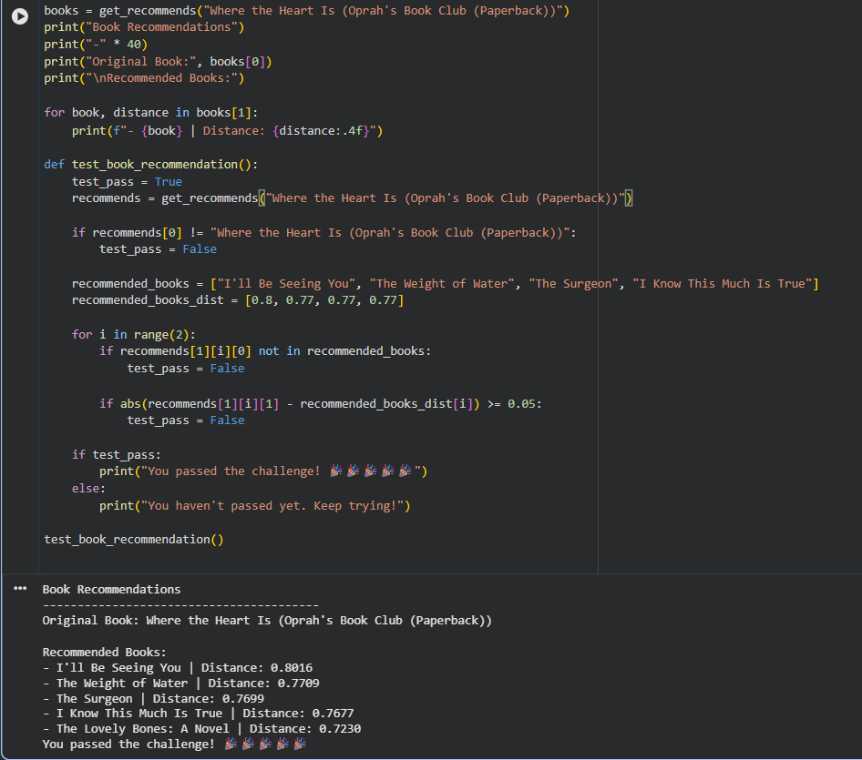

# Book Recommendation Engine

## Project Overview
A machine learning project that recommends similar books based on user ratings using the K-Nearest Neighbors (KNN) algorithm.

## Technologies Used
- Python
- Pandas and NumPy
- Scikit-learn
- SciPy
- Jupyter Notebook

## Project Workflow
1. Load and explore the Book-Crossing dataset.
2. Filter users and books based on rating counts.
3. Create a user-book rating matrix.
4. Train a KNN model using cosine distance.
5. Recommend similar books based on user preferences.

## Results
Successfully completed the freeCodeCamp Book Recommendation Engine challenge.

## How to Run
Open `book_recommendation_engine.ipynb` in Google Colab or Jupyter Notebook and run the cells in order.

## Dataset
Book-Crossing dataset provided by freeCodeCamp for educational purposes.

## Recommendation Results

